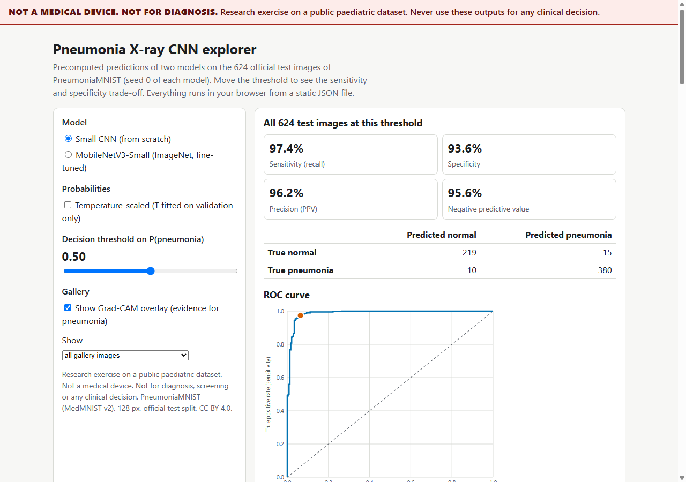
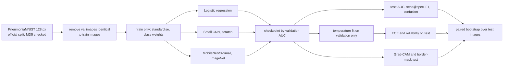
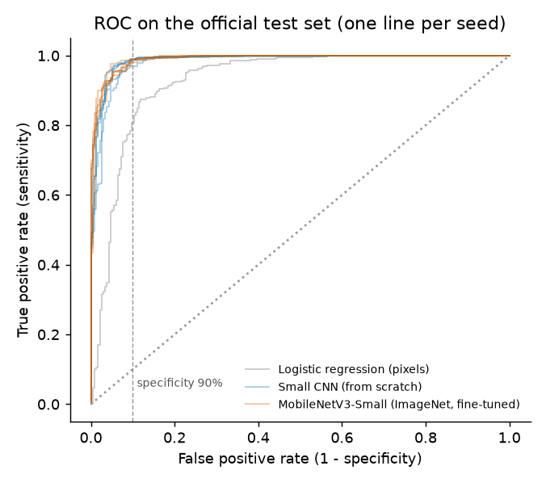
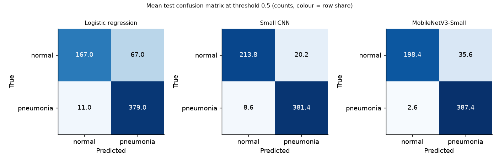
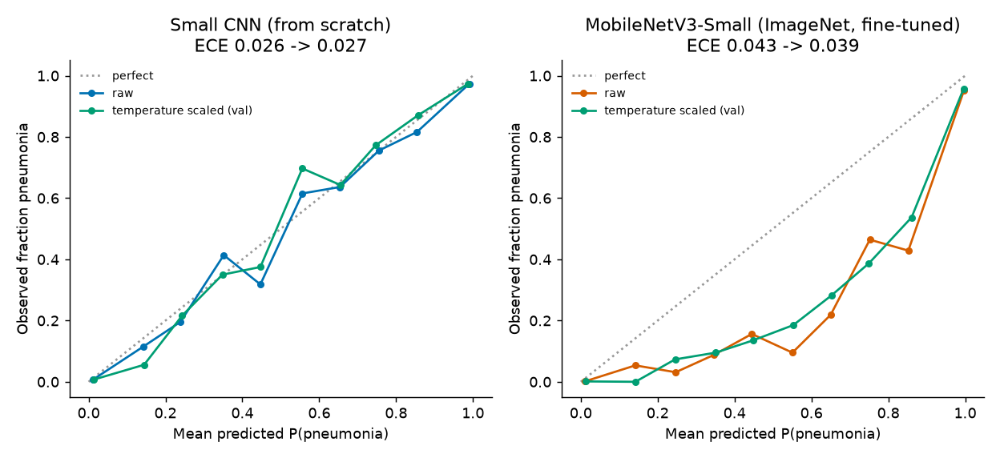
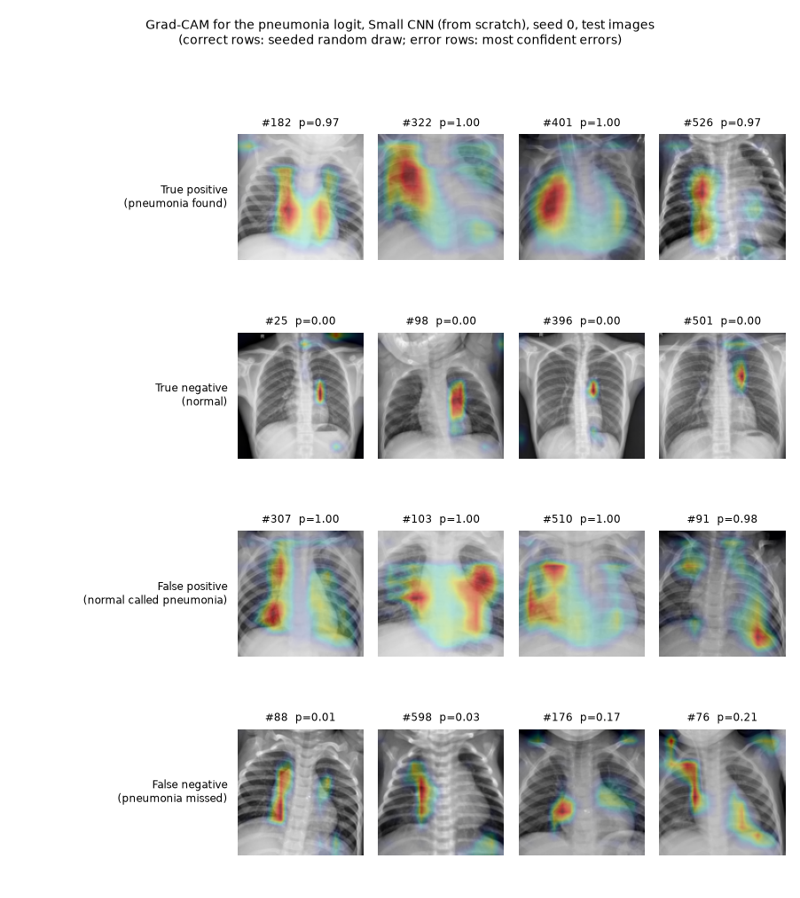
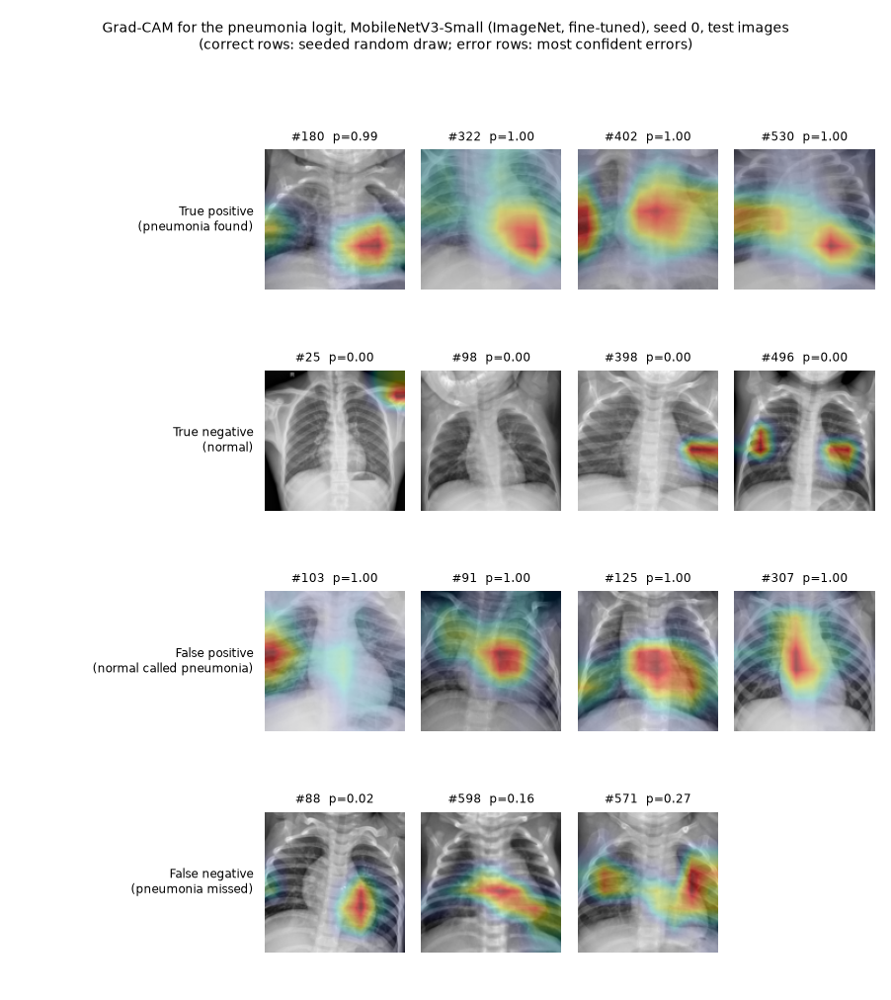
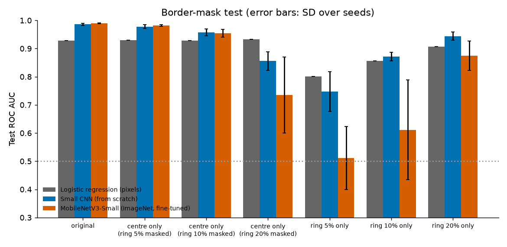

# pneumonia-xray-cnn: a rigorous, honest CNN study on paediatric chest X-rays

[](https://creativecommons.org/licenses/by-nc-nd/4.0/)

> **Not a medical device. Not for diagnosis.** This is a research and teaching exercise on a public,
> single-centre paediatric dataset. Nothing here has been clinically validated, and none of the outputs, models or
> figures may be used for screening, diagnosis or any clinical decision.

## Summary

Binary classification (normal vs pneumonia) on PneumoniaMNIST at 128 px, official train/validation/test split,
CPU only, 5 seeds per CNN. All numbers below are from the committed runs in `results/` and `docs/runs/`
(2026-10-15) and are on the 624-image official test set. Brackets are bootstrap 95% intervals over test images
(2000 resamples; mean over seeds).

| Model | ROC AUC | Sensitivity at 90% specificity | Sensitivity / specificity at 0.5 | ECE (raw) |
|---|---|---|---|---|
| Logistic regression on pixels (baseline, 1 run) | 0.928 [0.903, 0.951] | 0.808 [0.635, 0.898] | 0.972 / 0.714 | 0.078 |
| Small CNN from scratch (0.21 M parameters, 5 seeds) | 0.986 [0.978, 0.993] | 0.985 [0.958, 0.996] | 0.978 / 0.914 | 0.026 |
| MobileNetV3-Small, ImageNet, fine-tuned (1.5 M parameters, 5 seeds) | 0.990 [0.984, 0.994] | 0.986 [0.957, 0.996] | 0.993 / 0.848 | 0.043 |

What the numbers say, and what they do not:

- Both CNNs clearly beat the pixel baseline (paired AUC difference +0.058 [0.038, 0.081] for the small CNN).
- Pretraining did **not** give a measurable AUC advantage over a small CNN trained from scratch (+0.004 [-0.001, 0.009]).
  It does matter for the same MobileNet architecture: random initialisation loses 0.020 AUC [0.012, 0.029] (3 seeds).
- The test set is harder than validation in a specific way. A threshold chosen on validation to reach 90% specificity
  gives only 0.66 (small CNN) and 0.53 (MobileNet) specificity on test. Test has 37.5% normal images against 26% in
  validation and the models over-call pneumonia on the test normals. Temperature scaling fitted on validation cannot fix
  that shift (see Calibration).
- A border-mask test shows the models do not collapse without the image border, but they lose 3 to 4 AUC points when a
  10% ring is masked, and the ring alone carries label information (AUC 0.86 for a classifier trained only on it). So
  border shortcuts are not ruled out (see Shortcut risks).

[Interactive explorer](docs/index.html): serve the folder with `python -m http.server 8000 --directory docs`
and open http://localhost:8000. It shows predictions, probabilities, Grad-CAM and a threshold slider with the
sensitivity/specificity trade-off for 624 test images. Checked with Playwright at 390 px and 1280 px, no console errors.



## Problem statement

Given a paediatric chest radiograph, predict normal vs pneumonia. The study asks four questions: how much does a
CNN improve on a trivial baseline, does ImageNet pretraining help, are the predicted probabilities trustworthy, and is the
model looking at the lungs or at artefacts. Metrics: ROC AUC (threshold free), sensitivity at fixed specificity,
precision/recall/F1 and the confusion matrix at 0.5, expected calibration error (ECE), and the effect of masking the border.

## Approach



- **Small CNN:** stride-2 stem and three double-convolution blocks (16 to 96 channels), batch norm, global average
  pooling, dropout, one logit. 0.21 M parameters.
- **Transfer model:** torchvision MobileNetV3-Small with ImageNet weights. The RGB stem is collapsed to one channel by
  summing its filters, the last stride-2 stage is set to stride 1 so Grad-CAM maps are 8x8 instead of 4x4, and the head
  is a single logit. Whole network fine-tuned.
- **Class imbalance:** class-weighted binary cross-entropy (positive weight = negatives/positives of the training set).
  Focal loss and no weighting are run as ablations.
- **Augmentation:** small rotations (up to 10 degrees), scale 0.9 to 1.1, shifts up to 5%, brightness and contrast
  jitter. **No flips**: vertical flips make anatomically impossible images, and horizontal flips move the heart to the
  right side.
- **Training:** AdamW, cosine schedule, batch 64, 15 epochs (small CNN, lr 2e-3) or 10 epochs (MobileNet, lr 5e-4), fixed
  seeds 0 to 4, checkpoint chosen by validation AUC. No hyperparameter search was run; these settings were fixed before
  looking at test results and are not tuned.
- **Baseline:** logistic regression on 4x4 block-averaged pixels, balanced class weights, C chosen on validation AUC.

## Data

- **Dataset:** PneumoniaMNIST from MedMNIST v2 (Yang et al., Scientific Data 2023), derived from the Kermany et al.
  (Cell 2018) paediatric chest X-ray set. Licence **CC BY 4.0**, no login. Downloaded at run time from Zenodo with an MD5
  check (128 px file `05b46931834c231683c68f40c47b2971`). Data is never committed (`data/` is git-ignored).
- **Split:** the official one shipped with the file, used unchanged except for one cleaning step. Official sizes are
  4708 train / 524 validation / 624 test. The test counts (234 normal, 390 pneumonia) match the source dataset's own test
  folder. Eight validation images are byte-identical to training images (all pneumonia), so they were removed from
  validation (516 left). Test shares no image with train or validation. Checked by `pxray check-data` and by tests.

| Split | Images | Normal | Pneumonia | Pneumonia share |
|---|---|---|---|---|
| Train | 4708 | 1214 | 3494 | 74.2% |
| Validation (after cleaning) | 516 | 135 | 381 | 73.8% |
| Test | 624 | 234 | 390 | 62.5% |

- **Known limitations of the data:**
  - Single centre, children aged roughly one to five, one scanner workflow. No external validation set was used.
  - Labels come from the source dataset's grading; some label noise is expected and is not quantified here.
  - Class imbalance (74% pneumonia in train) and a different class mix in test (62.5%).
  - Validation was split from the same pool as training, and MedMNIST does not provide patient IDs, so validation images
    may come from the same patients as training images. Validation scores (AUC around 0.997) are therefore optimistic and
    are not used to report performance.
  - Duplicates inside splits remain (18 in train, 3 in test).
  - Images are centre-cropped and downsampled from several thousand pixels to 128 px, which removes fine detail.

## Results

All values: test set, mean over seeds, seed SD in parentheses where useful. Full tables, including bootstrap intervals for every
column, are in [`results/summary.md`](results/summary.md) and `results/summary.json`.

| Metric | Logistic regression | Small CNN | MobileNetV3-Small |
|---|---|---|---|
| ROC AUC [95% CI] | 0.928 [0.903, 0.951] | 0.986 [0.978, 0.993] (SD 0.003) | 0.990 [0.984, 0.994] (SD 0.002) |
| Sensitivity at 90% specificity | 0.808 [0.635, 0.898] | 0.985 [0.958, 0.996] | 0.986 [0.957, 0.996] |
| Sensitivity at 95% specificity | 0.551 [0.282, 0.768] | 0.930 [0.836, 0.977] | 0.942 [0.895, 0.976] |
| Accuracy / balanced accuracy at 0.5 | 0.875 / 0.843 | 0.954 / 0.946 | 0.939 / 0.921 |
| Precision / recall / F1 at 0.5 | 0.850 / 0.972 / 0.907 | 0.950 / 0.978 / 0.964 | 0.916 / 0.993 / 0.953 |
| Mean confusion (TN / FP / FN / TP) at 0.5 | 167.0 / 67.0 / 11.0 / 379.0 | 213.8 / 20.2 / 8.6 / 381.4 | 198.4 / 35.6 / 2.6 / 387.4 |
| Test sensitivity / specificity at the threshold giving 90% specificity on validation | 0.987 / 0.611 | 0.999 / 0.662 | 1.000 / 0.532 |

Seeds change initialisation and batch order only; the data split is fixed. Intervals reflect test-image sampling only (a
paired bootstrap with the same resample for every model and seed), so they do not include training variance (listed as SD)
or the dataset shift to other hospitals.




### Calibration

Temperature scaling (one scalar T fitted on validation logits by minimising NLL, never on test) before and after:

| Model | T (mean, SD over seeds) | ECE raw [95% CI] | ECE scaled [95% CI] | NLL raw to scaled | Brier raw to scaled |
|---|---|---|---|---|---|
| Logistic regression | 0.82, 0.00 | 0.078 [0.061, 0.106] | 0.093 [0.074, 0.120] | 0.419 to 0.467 | 0.100 to 0.102 |
| Small CNN | 1.16, 0.28 | 0.026 [0.024, 0.042] | 0.027 [0.029, 0.043] | 0.144 to 0.147 | 0.038 to 0.038 |
| MobileNetV3-Small | 1.24, 0.16 | 0.043 [0.036, 0.062] | 0.039 [0.033, 0.058] | 0.222 to 0.197 | 0.050 to 0.049 |

ECE uses 15 equal-width bins on the confidence of the predicted class. The small CNN is already well calibrated on test
and temperature scaling changes nothing measurable. The MobileNet is over-confident for pneumonia on test: when it predicts
0.75 to 0.85 the observed pneumonia fraction is about 0.4 to 0.5. Scaling fitted on validation barely helps because the validation to
test shift is not a temperature problem. For logistic regression, scaling on validation makes test calibration worse.
A percentile bootstrap of ECE is biased upward, which is why a point estimate can sit at or below the lower bound.



### Ablations (small CNN and MobileNet, seeds 0 to 2, paired bootstrap)

| Change | AUC difference | Specificity at 0.5 difference | Sensitivity at 0.5 difference |
|---|---|---|---|
| Small CNN without class weights | -0.005 [-0.009, -0.003] | -0.160 [-0.195, -0.129] | +0.020 [0.009, 0.031] |
| Small CNN with focal loss instead of weighted BCE | -0.003 [-0.006, 0.001] | -0.020 [-0.037, -0.006] | +0.001 [-0.005, 0.006] |
| Small CNN without augmentation | -0.011 [-0.020, -0.004] | -0.121 [-0.156, -0.091] | +0.017 [0.008, 0.027] |
| MobileNetV3-Small with random initialisation | -0.020 [-0.029, -0.012] | -0.296 [-0.343, -0.250] | +0.000 [-0.007, 0.007] |

Class weighting mostly moves the operating point (specificity) rather than the ranking quality (AUC). Focal loss matches
weighted BCE on AUC but is worse calibrated (ECE 0.088 against 0.027). Augmentation helps AUC and specificity.

## Explainability and shortcut risks

Grad-CAM uses the pneumonia logit and the last convolutional block. Rows show true positives, true negatives (seeded random
draws) and the most confident false positives and false negatives of seed 0.




**Shortcut learning in chest X-ray data.** Classifiers can pick up cues that correlate with the label but are not disease:
laterality and text markers, burned-in annotations, collimation edges and image borders, differences in positioning,
exposure or scanner between sites and over time, and support devices such as tubes or leads that are more common in sick
patients. In a single-centre set the two classes may also differ in acquisition details, which a model can exploit without
learning anything about lungs. In the MedMNIST version images are centre-cropped and resized, which removes some but not all of this. Two observations from the
Grad-CAM grids above: on one true-negative image the attention sits in the top-right corner, outside the lungs (image 25
in the MobileNet figure), and several false-positive cases have attention over the mediastinum and heart region.

**Border-mask test** (test AUC, mean over seeds, SD in parentheses; ring width as a share of the image side; models are
*not* retrained on masked inputs; logistic-regression rows are separate classifiers trained on the masked pixels as a
data-level probe):

| Model | Original | Centre only (10% ring masked) | Centre only (20% ring masked) | Ring only (5%) | Ring only (10%) | Ring only (20%) |
|---|---|---|---|---|---|---|
| Logistic regression | 0.928 | 0.929 | 0.933 | 0.800 | 0.857 | 0.908 |
| Small CNN | 0.986 (0.003) | 0.958 (0.012) | 0.856 (0.033) | 0.747 (0.071) | 0.871 (0.015) | 0.944 (0.014) |
| MobileNetV3-Small | 0.990 (0.002) | 0.954 (0.014) | 0.735 (0.134) | 0.512 (0.112) | 0.611 (0.177) | 0.875 (0.052) |



Grad-CAM mass inside the outer 10% ring (a ring covering 36.5% of the image area): 0.23 for the small CNN and 0.30 for the
MobileNet, averaged over test images and seeds (0.31 and 0.41 on true negatives, 0.19 and 0.26 on true positives).

How to read this, without over-claiming:

- Both models keep most of their performance (AUC 0.95 to 0.96) when the outer 10% is masked, and their attention mass in
  the ring is below what a uniform map would give. That is consistent with, but does not prove, that they rely mainly on
  the lung field.
- The drop of 3 to 4 AUC points, the larger drop at 20% (which also removes peripheral lung), and the high variance across
  MobileNet seeds show some dependence on the periphery. A classifier trained on the 5% ring alone reaches AUC 0.80, so the
  outermost pixels carry label information in this dataset (frame, markers, body outline). A model could use it.
- Masking with a constant creates out-of-distribution inputs, so a drop mixes "information removed" with "unfamiliar input".
  The test cannot separate the two. A stronger check would retrain on masked data, use external hospitals, or use
  pixel-level annotations. None of that is done here.

## Tech stack

Python 3.11, PyTorch 2.14 (CPU), torchvision, scikit-learn, SciPy, Matplotlib, Pillow, pytest, ruff. A static HTML/JS
explorer with no server. CI runs lint and the fast tests only.

## Getting started

Prerequisites: Python 3.11 and about 1 GB of disk (the dataset file is 75 MB, CPU PyTorch about 200 MB).

```bash
git clone https://github.com/Janeferdinant/pneumonia-xray-cnn.git
cd pneumonia-xray-cnn
python -m venv .venv
source .venv/bin/activate            # Windows PowerShell: .venv\Scripts\Activate.ps1
python -m pip install -r requirements.txt
python -m pip install -e . --no-deps

ruff check . && ruff format --check .      # expected: All checks passed!
pytest -q                                  # expected: 43 passed (the dataset test also runs once data is downloaded)

python -m pxray download                   # fetches the 75 MB file, verifies MD5
python -m pxray check-data                 # prints split sizes, label counts, duplicate counts
python -m pxray train                      # baseline + small CNN + MobileNet, 5 seeds each (about 1 h on 16 threads)
python -m pxray train --run small_cnn_unweighted small_cnn_focal small_cnn_noaug mobilenet_v3_small_scratch --seeds 0 1 2
python -m pxray evaluate                   # writes results/summary.md|json and docs/figures (about 2 min)
python -m pxray explain                    # Grad-CAM figures, border statistics
python -m pxray export-demo                # explorer data and thumbnails under docs/data
python -m http.server 8000 --directory docs
```

Each single run stays under the 25 minute limit: about 6 minutes per seed for MobileNet and 7 minutes for the small CNN on 16
logical CPUs. The first three small CNN seeds took 17, 10 and 9 minutes because other jobs were running at the same time (see
`docs/runs/`). A `Makefile` wraps the same steps (`make all`).
Trained weights are written to `artifacts/` and are not committed. Run logs with dates, seeds and hardware are in
[`docs/runs/`](docs/runs).

## Project structure

```
src/pxray/    data, augment, models, losses, train, metrics, calibration, bootstrap, gradcam, shortcut,
              baseline, experiment, report, explain, export_demo, cli
tests/        data pipeline and leakage, metrics and ECE on toy data, bootstrap, Grad-CAM shapes, determinism
results/      summary.md/json, per-run predictions (logits only), run histories, explain.json, data_report.json
docs/         index.html explorer, data/ (JSON and 96 px PNGs), figures/, runs/ logs, screenshots/
```

## Real-world applications

Chest radiograph triage is a real research area, but this repository does not support any clinical use. What transfers is
the evaluation recipe: report ranking and threshold metrics separately, choose thresholds on held-out data and check them
on the deployment distribution, calibrate probabilities, and test whether a model uses the right pixels.

## Limitations

- Research exercise only. Not validated clinically, not a medical device, not for diagnosis.
- One dataset from one hospital and one age group. The results say nothing about adults, other scanners or other countries.
- Official validation is optimistic (same pool as train, possible patient overlap). The test set is the only held-out
  estimate and it was used once for reporting; no model selection used it, but the ablation and mask experiments were
  designed after seeing earlier results.
- Only two architectures, no hyperparameter search, a single data split, 5 seeds (3 for ablations).
- Bootstrap intervals cover test-image sampling, not patient clustering (no patient IDs are available) and not the shift to
  other sites.
- The border-mask test shows dependence on the periphery but cannot isolate shortcuts from legitimate peripheral signal.
- Grad-CAM is a coarse, class-sensitive heuristic, not proof of what the model uses.
- No bacterial versus viral distinction, no localisation ground truth.

## Future scope

- Retrain with border and marker removal or random border masking, and compare with the current models.
- Patient-level splits and an external test set from another hospital (for example a different paediatric collection)
  to measure the real shift.
- Calibrate on a sample that matches the deployment mix (prior-shift correction or a small target-domain calibration set).
- 224 px inputs and larger backbones, and ensembling across seeds.
- Sanity checks for saliency (randomised-weight tests) and pixel-level annotation of lung fields.

## Credits and citation

Data: Yang et al., "MedMNIST v2", Scientific Data 10, 41 (2023); Kermany et al., Cell 172(5), 1122 (2018). Methods: Grad-CAM
(Selvaraju et al. 2017), temperature scaling (Guo et al. 2017), focal loss (Lin et al. 2017), MobileNetV3 (Howard et al. 2019).
Sources, licences and required attributions are in [THIRD_PARTY_NOTICES.md](THIRD_PARTY_NOTICES.md).

## License

Original work (c) Jane Rose Ferdinant, licensed CC BY-NC-ND 4.0 (see `LICENSE`). Third-party components retain their own
licenses; see THIRD_PARTY_NOTICES.md. The explorer's thumbnails are derived from PneumoniaMNIST and remain CC BY 4.0 with attribution.

## Author

Jane Rose Ferdinant: [portfolio](https://janeferdinant.vercel.app) | [LinkedIn](https://www.linkedin.com/in/janerosenf/)
